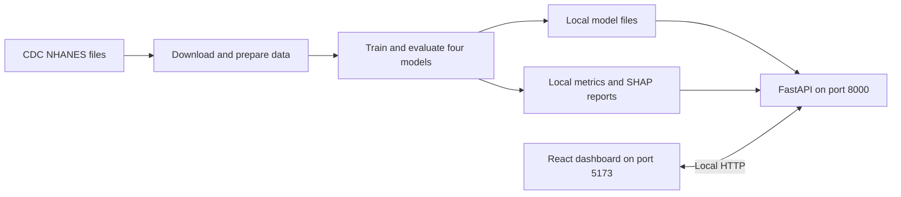
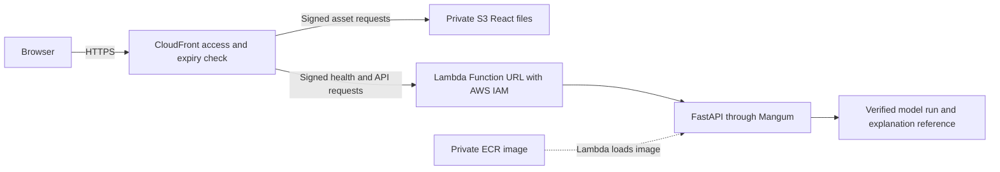
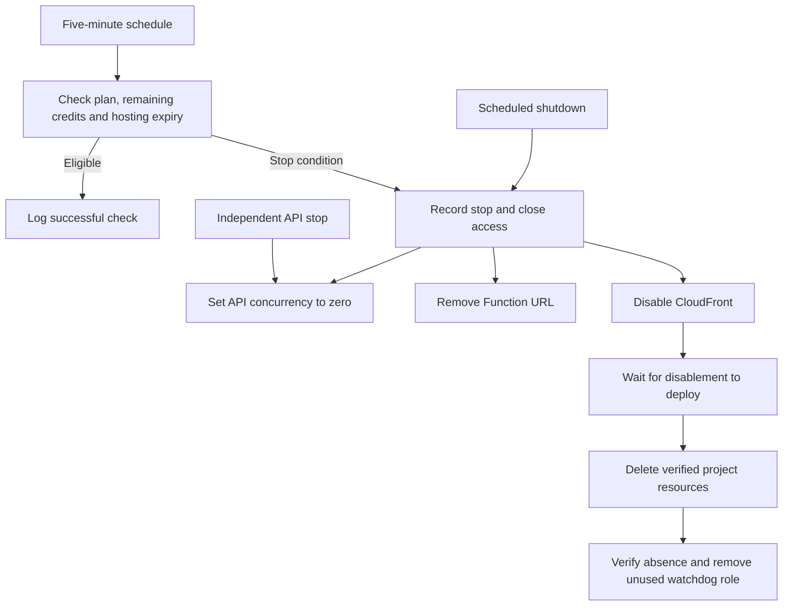

# Application architecture

The dissertation and April `main` describe a local React and FastAPI application. The November AWS work kept those two application layers and changed how the dashboard is served, how requests reach the API and how the API loads a run.

## April submission

Section 4.2 and Figure 4.1 of the dissertation describe three layers. The data layer downloads, cleans and joins NHANES files. The machine learning layer trains and evaluates the four models and writes the results to disk. The presentation layer uses FastAPI to serve predictions and analysis to a React dashboard. The diagram below summarises that design and the local request path in [April main](https://github.com/Nakib16K/fyp-nhanes-t2d/tree/aa77d31d105ee394ed5bed551edd732977db788c).

The original API loaded shared model files and selected a report folder separately. The dashboard already had Model Comparison and Exploratory views. Training ran separately from browser requests.

## From local use to the hosted demo

| Area | April submission | November release |
|---|---|---|
| Dashboard | React served locally by Vite | Compiled React files in private S3, served through CloudFront |
| API | Browser calls the local FastAPI server | CloudFront forwards API requests to a Lambda Function URL. Mangum passes events to FastAPI |
| Models and reports | Shared model directory and a separately selected report folder | One verified run supplies models, reports and thresholds. Two additional files supply the reference for local logistic regression explanations |
| Access | Local development setup | One HTTPS entry point, a shared demo credential and AWS-signed requests to both origins |
| Operations | Developer starts and stops the local servers | Scheduled eligibility checks, an independent API stop and removal of the demo resources |

A temporary private Lambda trial came first. It tested the container through authenticated Lambda invocation and removed all four trial resource types afterwards. The browser deployment added CloudFront and private S3. The 18 November release updated the Lambda image, frontend assets and shutdown controls within that existing layout. See the [development history](POST_SUBMISSION_DEVELOPMENT.md).

The demo uses on-demand Lambda because it runs the FastAPI app and the same verified models without a dedicated server running between visits. CloudFront serves the dashboard and API at one HTTPS address and keeps both origins private. The demo has a fixed Free Plan window, a shared credential and capacity for one API request at a time. The first request after an idle period can take longer. See [startup and capacity](HOSTING_OPERATIONS.md#startup-and-capacity).

## Hosted request path

The CloudFront viewer function checks the demo credential and expiry for every request. It then removes the viewer's Authorization header. CloudFront uses origin access control to sign requests to S3 and Lambda. The Function URL requires AWS IAM authentication. Its policy grants access to the demo distribution. For POST and PUT, the browser hashes the exact request body for CloudFront to sign. See [AWS's Lambda origin guidance](https://docs.aws.amazon.com/AmazonCloudFront/latest/DeveloperGuide/private-content-restricting-access-to-lambda.html).

| Component | Configuration verified on 18 November |
|---|---|
| CloudFront | HTTPS. The default route serves `site/` from S3. `/health` and `/api/*` go to Lambda. Caching is disabled, with zero configured error-cache TTLs. API forwarding excludes the viewer's Host header. |
| S3 and ECR | S3 blocks public access and allows the selected distribution to read its asset prefix. Private ECR holds the recorded image. |
| API Lambda | x86-64 container in `eu-north-1`, 2,048 MiB, 120-second timeout and reserved concurrency of one. The application role writes only to its own log group. |
| Watchdog and Scheduler | A separate Lambda reads plan and credit status and can stop and remove the project's resources. Scheduler can call it and independently set API concurrency to zero. |
| CloudWatch | API and watchdog logs have seven-day retention. CloudFront access logging was disabled in this configuration. |

The demo uses authenticated internet access with private origins. See [privacy and limitations](PRIVACY_AND_LIMITATIONS.md) for input handling and the scope of the shared credential.

## Shutdown path

Once the watchdog records a stop, later healthy billing readings cannot reopen the demo. The viewer expiry and independent API stop provide separate controls. See [hosting operations](HOSTING_OPERATIONS.md#hosting-limits) for the dated cutoff, early-stop conditions and cleanup checks.
